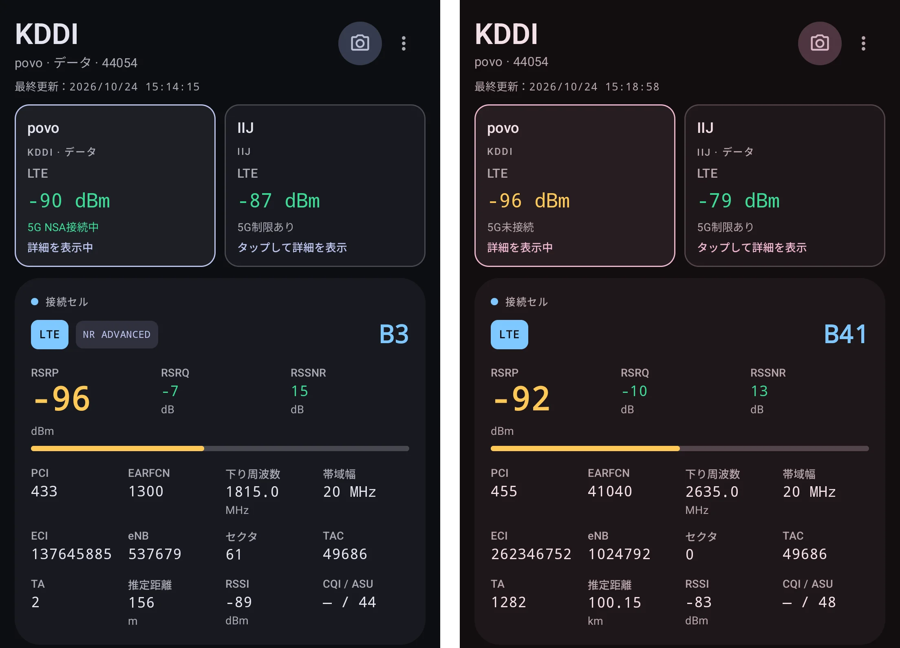
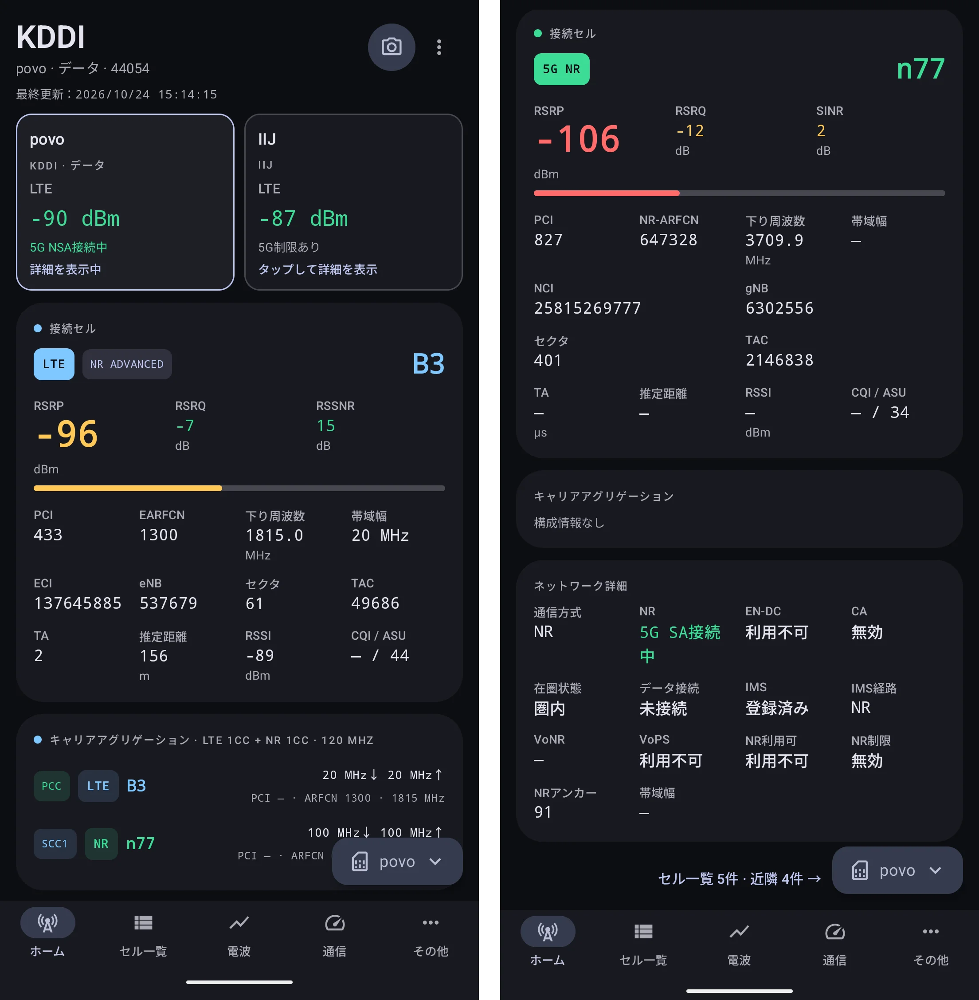
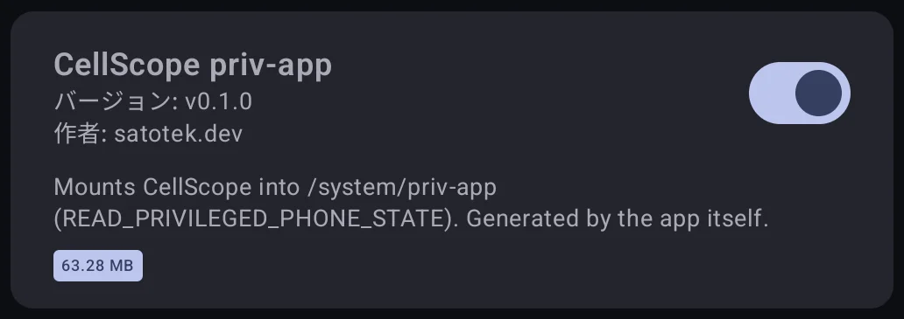
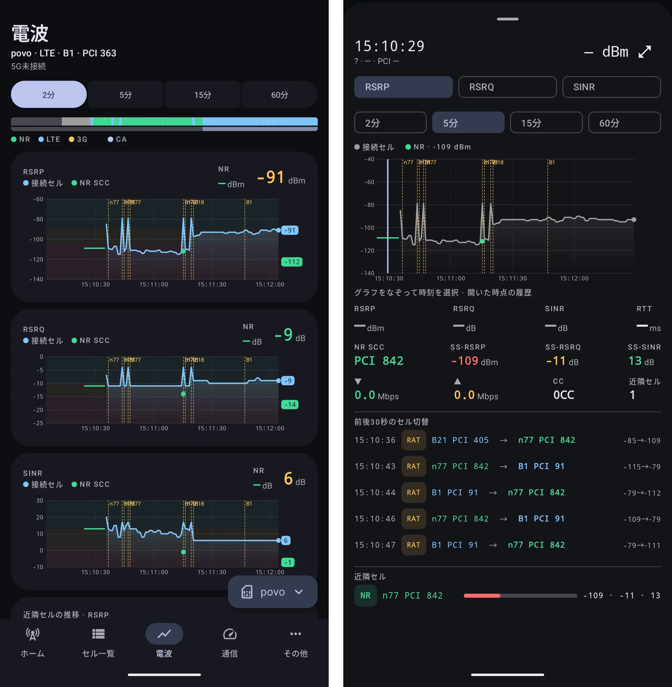
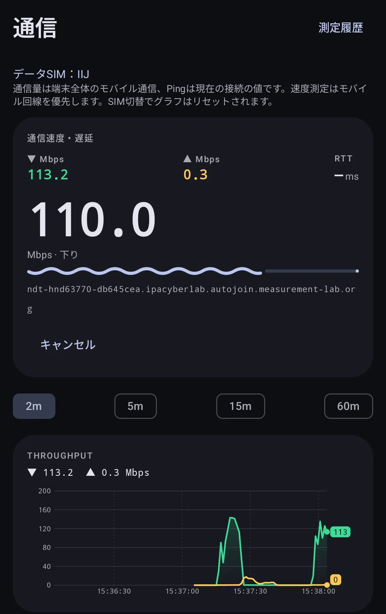
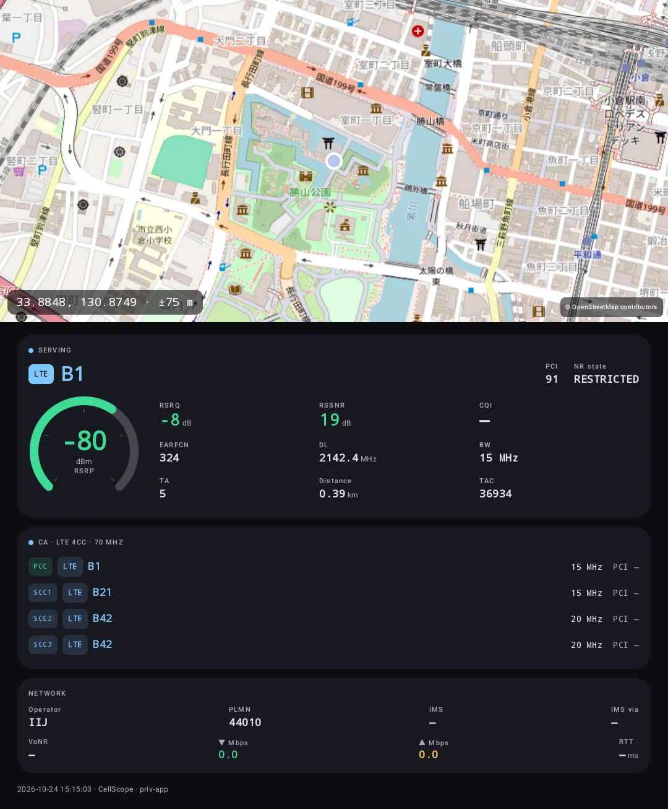

{/* 画像1: cover。CellScope のホーム画面（CA 構成が表示されている状態）。決まったら frontmatter に cover: ./assets/home.webp を足す */}

Pixel 11 を買ってから、5G の接続状態をもう少し詳しく見たくなりました。

Android には NetMonster のように電波情報を確認できるアプリがあります。ただ、実際にどの周波数帯を使っているのか、Carrier Aggregation（CA）がどう組まれているのかまで見ようとすると、少し物足りません。

こうした用途では Network Signal Guru（NSG）が有名ですが、残念ながら Pixel 11 では使えません。

そこで、Android から取れる情報をできる限り可視化するアプリ「CellScope」を作りました。

ソースコードは GitHub で公開しています: [satotek/cellscope](https://github.com/satotek/cellscope)

## Network Signal Guru が使えない

Network Signal Guru は、スマートフォンのモデムから詳細な無線情報を取得できる Android アプリです。

一般的な電波情報アプリでも RSRP や SINR、接続バンドくらいは確認できます。NSG は対応端末であれば、RRC や NAS のシグナリングメッセージといった、さらに下のレイヤーの情報まで見られます。バンド固定のような操作もできます。

これは Qualcomm 製モデムの DIAG インターフェースを使って、モデム内部の診断情報に直接アクセスしているからです。

一方、Pixel 11 は Google Tensor G6 を搭載していて、モデムは Samsung の Shannon 系です。Qualcomm DIAG はそもそも存在しないので、NSG と同じ方法では情報を取れず、Pixel 11 は NSG の対応端末にも入っていません。

root 化すれば解決する、という話でもありません。モデム側のインターフェースが違うことによる、構造的な制約です。

NSG と同等のものを一から作るのは現実的ではありません。ただ、Android の Telephony API と、root 権限で読めるシステム情報を組み合わせれば、日常的に電波を観察するのに必要な情報はそれなりに取れそうです。

それなら自分で作ってみよう、というのが今回のきっかけです。

## CellScope でできること

CellScope は、Android のセルラー通信の情報を表示・記録するアプリです。

Pixel 11 で使うことを前提にしていて、接続中のセルの情報だけでなく、CA 構成や電波品質の推移、通信速度までまとめて確認できます。

主な機能は次のとおりです。

- **セル情報**: LTE / NR の RSRP、RSRQ、SINR、PCI、バンド、周波数など
- **CA 構成**: LTE と NR それぞれの Primary / Secondary Component Carrier と帯域幅
- **電波の履歴**: RSRP、RSRQ、SINR、近隣セルの時系列グラフと、セル変更イベント
- **通信**: スループットと Ping の推移、NDT7 による速度測定
- **統計**: 在圏バンドの比率や、電波品質の分布
- **ログ**: CSV / JSONL への記録と、あとからの再生
- **スナップショット**: 地図と通信状態を 1 枚にまとめたカード画像の保存
- **訪問セル**: これまでに接続したセルを端末内に記録
- **PiP・オーバーレイ**: 他のアプリを使いながら通信状態を確認
- **無線制御**: 5G SA のみ、LTE のみといった通信方式の固定

デュアル SIM にも対応していて、ホーム画面で両方の SIM の状態を並べて見られます。

ただし、これらすべてが通常の Android アプリの権限で取れるわけではありません。後で書くように、使える権限によって表示できる項目が変わります。

{/* 画像2（任意）: ホーム画面をライトテーマで 1 枚。あれば機能紹介のここに置く */}

## Kotlin + Jetpack Compose でネイティブアプリとして作る

CellScope は Kotlin と Jetpack Compose で書いた、Android のネイティブアプリです。

普段は Web まわりの技術を触ることが多いので、React Native や Flutter のようなクロスプラットフォームのフレームワークを使う選択肢もありました。

ただ、今回は最初から Pixel 11 で使うことが目的で、iOS 対応は必要ありません。それに、CellScope は `TelephonyManager` や `TelephonyCallback` といった Android 固有の API を大量に使います。特権 API や root 権限を使う処理もあるので、クロスプラットフォームのフレームワークを選んでも、結局ネイティブのコードを書く部分が大半になりそうでした。

普段あまり触らない Kotlin でも踏み切れたのは、AI コーディングツールのおかげです。慣れている技術より、作りたいものに合った技術を選べるようになりました。ただ、非公開 API や端末依存の挙動は AI に聞いても分からないことが多く、結局は実機で確かめるしかありませんでした（このあたりは後述のハマりどころにも出てきます）。

### UI は Jetpack Compose

UI は Jetpack Compose で書いています。

以前の Android 開発では XML でレイアウトを定義するのが一般的でしたが、Compose では Kotlin のコードで UI を宣言的に書けます。状態に応じて UI が再構成されるという考え方は React と似ていて、Web 側から来た身としては馴染みやすいものでした。

CellScope は、接続方式や電波品質、接続セルなど、時間とともに変わる情報を大量に扱います。取得した通信情報を状態として持ち、それに合わせて UI が組み直される Compose とは相性が良いと感じました。

一方で、電波情報はほぼ毎秒更新されるので、何も考えないと不要な再コンポジションが走ります。状態をどこで分割するか、いつ更新するかには気を配る必要がありました。

## Material 3 Expressive で Pixel らしい UI にする

せっかく Pixel 向けに作るなら、見た目もできるだけ Pixel に馴染ませたいと考えました。

そこで採用したのが Material 3 Expressive（M3E）です。Material Design 3 を発展させたデザインシステムで、形状やタイポグラフィ、モーションがより表現豊かになっています。Pixel のシステム UI とも揃っているので、標準アプリに近い雰囲気にできます。

CellScope では、トーナルなカードや `ShortNavigationBar`、`ButtonGroup` を使ったトグルなどを Compose の Material 3 コンポーネントで組んでいます。M3E の部品は執筆時点ではまだ Material 3 のベータ版にしか入っていないので、Compose BOM もベータ版を使っています。

配色は Material You のダイナミックカラーに対応させていて、壁紙に合わせてアプリの色が変わります。ただ、RAT（通信方式）の色や、電波品質の良い / 普通 / 悪いを表す色は、意味を持つ色として固定しています。

個人的には、ツール系のアプリでも見た目や操作感は大事だと思っています。

電波情報アプリはどうしても数値だらけになりがちですが、すべての値を同じ大きさで並べると、かえって必要な情報が見つけにくくなります。そこで、RSRP のように頻繁に見る値は大きく表示し、詳細なセル情報や統計は別の画面に分けました。数値も単に並べるだけでなく、色やグラフで状態がひと目で分かるようにしています。

M3E のコンポーネントを使うことで、独自のデザインシステムを一から作らずに、Pixel らしい UI に仕上げられました。

## Android からどこまで通信情報を取得できるのか

### 公開 API で取れるもの

Android には、モバイル通信の情報を取得するための `TelephonyManager` があります。

たとえば `CellInfo` を使うと、接続中のセルや周辺セルの情報が取れます。LTE なら RSRP、RSRQ、RSSNR、PCI、TAC、EARFCN などが代表的です。5G NR でも、SS-RSRP、SS-RSRQ、SS-SINR、NR-ARFCN などが取れる場合があります。

CellScope では、EARFCN や NR-ARFCN から 3GPP の規格表をもとにバンドと周波数を計算して表示しています。モデムがバンドを直接返してくれる場合はそちらを優先します。

更新は `TelephonyCallback` で受け取っています。セル情報、電波強度、`ServiceState`、表示用のネットワーク種別などのリスナーを登録して、変化があれば UI に反映します。

ちなみに、`CellInfo` は位置情報の権限がないと空のリストが返ってきます。電波情報アプリなのに位置情報の許可を求めるのはこのためです。

### ステータスバーの「5G」と実際の接続は別物

5G には大きく分けて NSA（Non-Standalone）と SA（Standalone）があります。NSA は LTE をアンカーにして NR を組み合わせる方式、SA は LTE を使わずに NR と 5G Core だけで通信する方式です。

少しややこしいのが、ステータスバーの「5G」表示と、実際の NR の接続状態が必ずしも一致しないことです。

ステータスバーの表示に使われる `TelephonyDisplayInfo` は、あくまでユーザー向けの表示のための情報です。`NR_NSA` になっていても、それは「このエリアで 5G が使える」という意味でしかなく、いま NR で通信していることの根拠にはなりません。

そこで CellScope では、データ通信の RAT が NR なら SA、鮮度のある NR のセル情報や物理チャネルの情報があれば NSA で接続中、と判定しています。どちらの根拠もない場合は、「5G 利用可」「制限あり」「不明」のどれかとして表示します。

下の 2 枚は、どちらも povo の SIM で撮ったホーム画面です。左は LTE の B3 をアンカーに n77 を束ねた NSA で、ステータスバーは「5G+」です。右は n77 の SA で繋がっているのに、ステータスバーは「4G」と表示されています。ステータスバーだけを見ていると、実際の接続とは逆の印象を受けることもあるわけです。

また、`ServiceState` の `toString()` には、`nrState` や `isEnDcAvailable` といった非公開フィールドが含まれています。root なしでこれらを読む方法は、この文字列をパースするくらいしかありません。しかも Android 17 では `nrState` がマスクされるようになったので、他の値から推定しています。OS のアップデートで壊れやすい部分です。

### Carrier Aggregation の構成を取る

今回、特に見たかったのが CA の構成です。

たとえば LTE の B3 に接続していると分かっても、それだけでは他にどの Component Carrier を束ねているのかは分かりません。

Android には `PhysicalChannelConfig` という、物理チャネルの構成を表すクラスがあります。チャネル番号や帯域幅、Primary / Secondary の区別など、CA 構成を知るのに必要な情報がそろっています。

ただし、これを取得する API には権限の制限があり、普通のサードパーティアプリからは使えません。

そこで root 権限を使うことにしました。

## root と priv-app で取れる範囲を広げる

CellScope は、使える権限に応じて 3 段階で動作します。

| 段階     | 権限                  | 主に取れる情報                                                                 |
| -------- | --------------------- | ------------------------------------------------------------------------------ |
| 通常     | 電話の状態 + 位置情報 | セル情報、電波品質、接続バンド、5G の状態など                                  |
| root     | 上記 + `su`           | `dumpsys` 経由の物理チャネル構成（CA）、IMS の登録状態、PDN ごとの接続情報など |
| priv-app | 上記 + 特権権限       | 物理チャネル構成の更新通知、VoNR の状態、通信方式の固定                        |

通常モードは Android の公開 API だけを使います。

root モードでは `su` 経由で `dumpsys telephony.registry` などを実行し、その出力をパースして、通常のアプリでは取れない情報を読みます。CA の構成もここから取っています。

さらに、KernelSU Next のモジュールとしてアプリを priv-app 化する仕組みも作りました。アプリ内の設定から有効化して再起動すると、CellScope が `/system/priv-app` に入った状態で起動します。

モジュールはアプリ自身が書き出すので、KernelSU Next のモジュール一覧にはこのように並びます。

priv-app になると `READ_PRIVILEGED_PHONE_STATE` などの特権権限が使えるので、`PhysicalChannelConfigListener` で CA 構成の変化をイベントとして受け取れます。`dumpsys` を定期的に叩いてポーリングする必要がなくなるのが利点です。

また、`setAllowedNetworkTypesForReason` を使った通信方式の固定もできるようになります。5G SA だけを使いたいとき（NSA は LTE のアンカーが必要なので、このモードでは使われなくなります）や、LTE に固定して比べたいときに便利です。ただし、実際にどの方式で繋がるかは、モデムやキャリア側の設定にも左右されます。

### priv-app 化でハマったところ

priv-app 化まわりは、思ったよりハマりました。

1 つ目は KernelSU Next のモジュールの仕組みです。KernelSU Next 3.x では `system/` のマウントが「メタモジュール」に任されていて、メタモジュールを入れていないとモジュールの中身がマウントされません。そこで、モジュール側で自前のマウント処理を持たせ、tmpfs に置いてから overlayfs で `/system/priv-app` に重ねるようにしました。`/data` が casefold の f2fs なので、overlayfs の下層に直接使えなかったのが tmpfs を挟んでいる理由です。

2 つ目は `PhysicalChannelConfigListener` です。必要な権限が足りないと、登録が黙って失敗し、最初の 1 回分の値だけが届いて以降は更新されない、という分かりにくい挙動になります。CA の表示が変わらないので、しばらく原因が分かりませんでした。

さらに、このリスナーを単独で登録すると、PCI が「不明」に伏せられた状態で届きます。位置情報の権限チェックが、位置に関係するイベントを含む登録のときにしか行われないためで、`CellInfoListener` と同じコールバックに同居させることで解決しました。

どちらもドキュメントには書かれておらず、実機で動かしてログを見ながら探るしかない部分でした。

## root 化しても取れない情報はある

ここまで作ってみて分かったのは、root 権限があっても取れない情報があることです。

たとえば、NSG のように RRC や NAS の L3 メッセージを見ることはできません。バンドやセルの固定も、Android にそのための API がなく、Tensor では実現できません。

Android Framework から見える情報と、モデムの中だけで管理されている情報の間には、はっきりした境界があります。root 化で Android 側の権限制限は回避できても、モデムが外に出していない情報が見えるようになるわけではありません。

ここが CellScope の限界です。

## 実際に Pixel 11 で使ってみる

CellScope では、いまの通信状態だけでなく、その変化を時系列で追えるようにしています。

同じ場所にいても、接続セルの切り替えや CA 構成の変化で通信品質は変わります。RSRP や SINR をグラフにし、セル変更のタイミングを縦線で重ねることで、どこで状態が変わったのかを追いやすくしました。グラフをタップすると、その時点の接続セル、NR の Secondary Cell、スループット、近隣セルなどを詳しく見られます。

下は povo で記録した 2 分間です。15:10 台の後半、B21 から n77 の SA に移ったあと、数秒おきに n77 と LTE の B1 を行ったり来たりしているのが黄色の破線で分かります。右はグラフをタップして開いた詳細で、前後 30 秒のセル切り替えが一覧で見られます。

通信速度や Ping も一緒に記録しているので、電波の品質と実際の通信性能を見比べることもできます。

速度測定には M-Lab の NDT7 を使っています。下は IIJ の SIM で測ったときの画面で、下りはおよそ 110 Mbps でした。測定中のスループットはグラフにもそのまま残ります。

ログは CSV と JSONL で書き出していて、あとから読み込んで再生できます。再生画面ではピンチで時間軸を拡大できるので、移動中に記録したログを見返すときに便利です。

気になる場所では、スナップショットで地図と通信状態を 1 枚の画像に残せます。これは IIJ（ドコモ回線）の SIM で撮ったもので、LTE の B1・B21・B42・B42 の 4 波、合計 70 MHz の CA が組まれていました。

ただし、Android が返すセル情報には更新周期や端末側の実装による制限があるので、常にモデムの最新の状態が見えているとは限りません。特に NR の Secondary Cell は、情報が取れなかったり、実際の接続状態と表示がずれたりすることもあります。

{/* TODO: povo やスリランカでの測定結果を別記事にする場合は、ここからリンクする */}

## NSG の代わりになるのか

結論として、CellScope は NSG の完全な代わりにはなりません。

NSG が対応モデムの診断インターフェースから取る情報と、CellScope が Android Framework を通して取る情報には大きな差があります。RRC / NAS のシグナリングメッセージのように、CellScope では取れない情報もあります。

一方で、普段使っている Pixel 11 で接続バンドや CA 構成、電波品質の推移を確認する、という用途であれば、必要な情報はかなり集められるようになりました。

電波状態の表示から履歴の記録、速度測定までを一つのアプリで完結できるのは、自作したからこそのメリットだと感じています。

## Play ストアには出していない

本当は Play ストアで公開したいのですが、今のところは GitHub でソースを公開するだけにしています。個人開発者にとって、公開までのハードルが上がっているためです。

2023 年 11 月以降に作った個人の開発者アカウントでは、本番公開の前に、12 人以上のテスターに 14 日間続けてクローズドテストに参加してもらう必要があります。自分用に作ったツールで、テスターを 12 人集めて 2 週間付き合ってもらうのはなかなか大変です。

アプリの性質の問題もあります。CellScope は電話の状態や位置情報の権限を使うので、審査ではそれぞれの用途の説明が求められます。root や priv-app を前提にした機能も、ストアで配るアプリとしてはかなり扱いにくい部類です。

さらに Android では、Play ストア以外から入れるアプリにも開発者の本人確認を求める仕組みが始まっていて、2027 年以降は世界的に広がる予定です。サイドロードで配る場合でも、いずれ同じような手続きは避けられなさそうです。

{/* TODO: Play ストア公開について自分の言葉で一言（今後の予定など）あれば足す */}

## おわりに

Pixel 11 で Network Signal Guru が使えないことをきっかけに作り始めた CellScope ですが、Android の Telephony API や root 権限、モデムと Android Framework の関係など、想像していた以上にいろいろなことを調べる機会になりました。

普段使っている Pixel に馴染む見た目で、自分が欲しかった機能を形にできるのは、個人開発ならではの面白さだと思います。

まだ取れない情報や端末依存の挙動もありますが、引き続き改善していくつもりです。

ソースコードはこちらです: [satotek/cellscope](https://github.com/satotek/cellscope)

## 参考

- [TelephonyManager | Android Developers](https://developer.android.com/reference/android/telephony/TelephonyManager)
- [PhysicalChannelConfig | Android Developers](https://developer.android.com/reference/android/telephony/PhysicalChannelConfig)
- [Material 3 Expressive | Material Design](https://m3.material.io/blog/building-with-m3-expressive)
- [Jetpack Compose の Material Design 3 | Android Developers](https://developer.android.com/develop/ui/compose/designsystems/material3)
- [Network Signal Guru](https://play.google.com/store/apps/details?id=com.qtrun.QuickTest)
